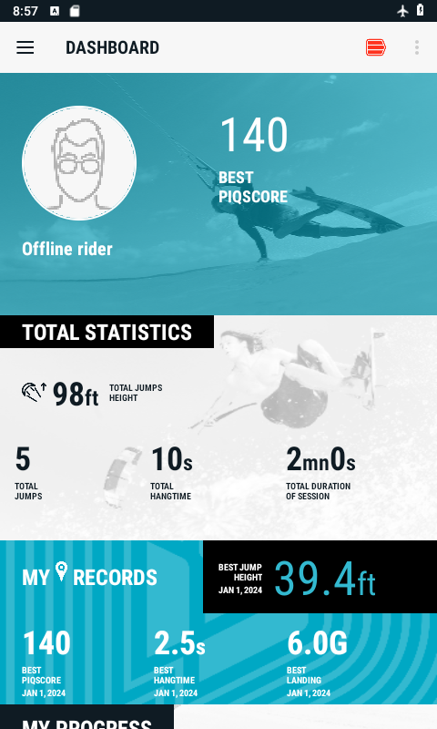
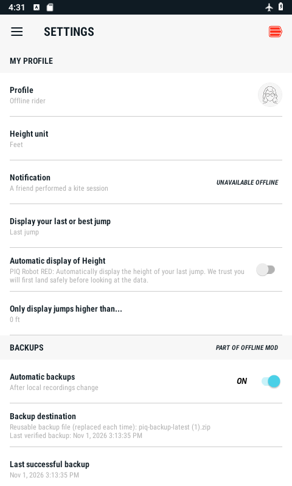
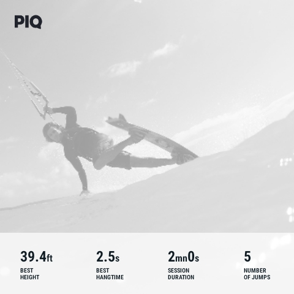

# PIQ Offline

Keep using your **Duotone / North PIQ kitesurf sensor** with sessions stored on your phone.

PIQ Offline is a community modification of the original Android app. It was created when the original online service stopped being usable, to help keep existing sensors useful and recordings accessible.

> **Unofficial community project.** PIQ Offline is independently maintained and is not affiliated with, endorsed by, or supported by PIQ or Duotone.
>
> Original software, trademarks and artwork remain the property of their respective rights holders. This project provides community modifications for offline use.

**[Download the Android APK](https://raw.githubusercontent.com/RimGu/PIQ-Offline/main/downloads/PIQ-Offline-592.apk)** · Build **592** · About **52 MB**

You only need the APK. No coding tools, source-code ZIP or original PIQ account are needed. Android will still ask you to confirm installation.

## Get started

1. **Download on your Android phone** using the button above.
2. **Open the downloaded APK and tap Install.** If Android asks, allow this browser or file manager to install the app.
3. **Open PIQ Offline and pair your sensor** using the sensor icon at the top right. Allow the Bluetooth/nearby-device or location permissions Android requests, then download your recordings.

Already using **PIQ Offline 2 / PIQ Offline**? Install this as an **update**. **Do not uninstall it or clear its data.** Keep the original PIQ app and first offline test app installed too: their stored history is not automatically imported.

[More installation and connection help →](docs/GETTING_STARTED.md)

## Original PIQ app no longer working?

If your Duotone / North PIQ Android app is stuck at login or registration, PIQ Offline lets you use supported sensor features without the retired online service. It bypasses the initial login/register screens and uses a local profile. The original dashboard and PIQSCORE screens read downloaded sessions and local calculations instead of requesting server data.

You can pair your kitesurf sensor, download recordings still on it, view sessions and save backups. This does not restore the old servers, online rankings or cloud history, and it cannot automatically import history from another installed app. Keep your original app and its data.

[Download and installation help](docs/GETTING_STARTED.md)

## A familiar app, using local data

*Example screens with sample recordings. Tap an image to enlarge it.*

## What changed?

- **Local access:** open the app without the retired registration and login service.
- **Sessions:** pair with the tracker, download recordings, view sessions and save notes using the original session workflow.
- **Dashboard and PIQSCORE:** keep the original layouts, using saved data on your phone. PIQSCORE shows a locally scored session; the old cloud calculation and rankings are unavailable.
- **Backups:** save a ZIP to a location you choose, with automatic backups and a local backup history.
- **Your profile:** edit your display name and choose a built-in avatar or a picture from your phone.
- **Sharing:** keep the original photo and statistic choices, with an optional PIQ logo and the Duotone/AND overlay removed.
- **Tracker storage:** restore the original recording cleanup and manual memory-erase controls.

### Sharing a session

## Keep a backup

Choose a backup ZIP during setup, or later in the **BACKUPS** section of **Settings**. Drive, OneDrive and other installed storage providers may appear in Android’s file picker.

Automatic backups run after local recording changes settle, while the app process is running. The selected ZIP is replaced with the latest backup; verified previous copies are kept on the phone for 30 days, with at least three previous versions when available. You can also tap **SAVE BACKUP ZIP** yourself.

The working collection stays in the app’s private storage. Check your storage provider’s upload status if you want an off-phone copy. Local backup history is lost if app data is removed. Backup ZIPs are unencrypted, so keep them somewhere private.

**Restoring an existing backup?** In **Settings**, scroll to **BACKUPS**, open **Offline backup settings** and choose **RESTORE BACKUP ZIP** before adding new sessions. Restore requires an empty collection and Bluetooth off; it does not merge collections. Close and reopen the app when prompted.

## What is still unavailable?

The retired online services are not recreated: online rankings, friends’ notifications, cloud account history, online maps/weather, spot requests, report sending and firmware downloads remain unavailable. These settings explain their offline limits in the app.

History held only in an old app or the old cloud account cannot automatically be recovered. You can download only recordings still on the tracker. Tracker cleanup follows the original logic again, so do not rely on transferred recordings staying on the sensor.

## Found a problem or have an idea?

[Open a GitHub issue](https://github.com/RimGu/PIQ-Offline/issues/new/choose). Include your phone model, Android version, app version and what happened. Screenshots help; please keep private backup ZIPs and personal recordings out of public issues.

### Does it work on your phone?

If you try PIQ Offline, [share a compatibility report](https://github.com/RimGu/PIQ-Offline/issues/new?template=compatibility_report.md). Successful tests are useful too: include your phone model, Android version, app build, and whether pairing, session download and backup worked. Report only what you actually tried; no need to erase data or reset your sensor.

This is a community test build. Earlier builds were used successfully on a Galaxy S22 with Android 16; the latest build has focused emulator checks. Physical tracker behavior and every phone/provider combination are not fully verified.

## Project notes

[Build 592 checks](docs/BUILD_592.md) · [APK checksum](downloads/SHA256SUMS) · [Installation and backup guide](docs/GETTING_STARTED.md)
